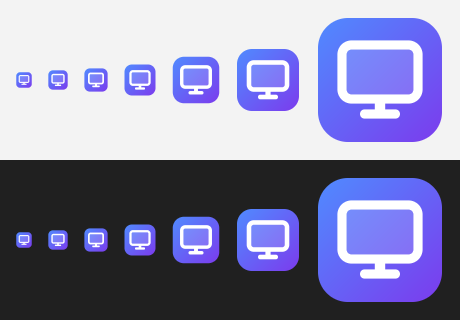
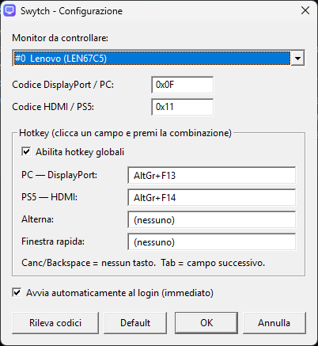

<p align="center">
  
</p>

<h1 align="center">Swytch</h1>

<p align="center">
  Switch your monitor's input (DisplayPort ↔ HDMI) with one key, over <b>DDC/CI</b>.<br>
  A tiny Windows tray app written in Rust, ready a few milliseconds after you sign in.
</p>

<p align="center">
  <a href="https://github.com/andreaalcaini/Swytch/actions/workflows/ci.yml"></a>
  <a href="https://github.com/andreaalcaini/Swytch/releases/latest"></a>
  <a href="LICENSE"></a>
</p>

---

PC on DisplayPort and a console on HDMI? Swytch sends the monitor the standard **VCP 0x60 (Input
Select)** command, the same one its own buttons use, so there's no OSD menu to dig through.

## Features

- **Global hotkeys** for DisplayPort, HDMI, *toggle* and the *quick switch* window (default
  **AltGr+F13…F16**, easy to map on a QMK/VIA keyboard).
- **Tray icon** with a menu to switch by hand, open the settings and exit.
- **Quick switch window** with two big PC/PS5 buttons. It opens on the *secondary* monitor, so you can
  still reach it after the main one has switched to the other input.
- **Hotkey recorder**: click a field and press the combination (Ctrl/Alt/Shift/Win/AltGr).
- **Auto-detection** of the DDC/CI capable monitor and of the input codes it supports.
- **Starts right at sign-in** through a logon scheduled task. *Run* entries are delayed by Windows for
  several seconds; this isn't. The hotkeys are registered first and work even before the taskbar is ready.
- **Lightweight**: plain Win32, zero dependencies, ~0.6 MB exe, a few MB of RAM. Fonts, windows and visual
  styles load only when you open a window.
- **English and Italian** UI, following the Windows display language.

<p align="center">
  
  &nbsp;&nbsp;
  
</p>

## Install

1. Download `Swytch-<version>-windows-amd64.exe` from the
   [latest release](https://github.com/andreaalcaini/Swytch/releases/latest) (or build it, see below).
2. Run:

   ```bat
   Swytch-<version>-windows-amd64.exe install
   ```

   The exe is copied to `%LOCALAPPDATA%\Programs\Swytch\Swytch.exe`, the logon task is created and the app
   starts. No admin rights needed. Running `install` with a newer exe updates it in place.

To remove the start at sign-in: `Swytch.exe uninstall` (or untick it in the settings).

## Usage

| Action | Default |
| --- | --- |
| DisplayPort input (PC) | AltGr+F13 |
| HDMI input (PS5) | AltGr+F14 |
| Toggle between the two | AltGr+F15 |
| Quick switch window | AltGr+F16 / double-click the icon |
| Menu | right-click the icon |

From the command line (handy for scripts): `Swytch.exe dp`, `Swytch.exe hdmi`, `Swytch.exe toggle`.

> **AltGr** is Ctrl+Alt on many layouts (e.g. Italian): Windows registers the hotkey as `Ctrl+Alt+F13`.

### Input codes

VCP 0x60 values depend on the monitor. The standard MCCS ones are `0x0F` = DisplayPort 1,
`0x10` = DisplayPort 2, `0x11` = HDMI 1, `0x12` = HDMI 2. **Settings → Detect codes** shows the current
input and the codes the monitor lists in its *capabilities*.

### Files

- Settings: `%APPDATA%\Swytch\config.ini` (`Language=auto|en|it` forces the UI language)
- Log (startup, hotkeys, switches): `%APPDATA%\Swytch\Swytch.log`

## Build

You need [Rust](https://rustup.rs). `rust-toolchain.toml` selects the `stable-x86_64-pc-windows-gnu`
toolchain, which ships its own linker, so no Visual Studio Build Tools are needed. Win32 is linked with
`raw-dylib`, without import libraries. `windres` (MinGW binutils, e.g. `winget install BrechtSanders.WinLibs.POSIX.UCRT`)
embeds the version info and the icon; without it the exe builds without them.

```bat
make build      :: target\release\Swytch.exe
make install    :: build and install for this user
make check      :: rustfmt + clippy + tests
make help       :: everything else
```

(`make` is GNU make; with WinLibs it is called `mingw32-make`.) Plain `cargo build --release` works too.

Releases are built by GitHub Actions: pushing a `vX.Y.Z` tag that matches the version in `Cargo.toml`
publishes the exe and its SHA-256 on the releases page.

## Requirements

- Windows 10 1703+ / Windows 11, x64
- A monitor with **DDC/CI** enabled (usually an option in its OSD). Docks, adapters and some KVM switches
  don't pass DDC/CI through.

## License

[MIT](LICENSE)
