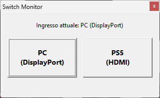

<p align="center">
  
</p>

<h1 align="center">Swytch</h1>

<p align="center">
  Cambia l'ingresso del monitor (DisplayPort ↔ HDMI) con un tasto, via <b>DDC/CI</b>.<br>
  Minuscola app per Windows nell'area di notifica, scritta in Rust, pronta in pochi millisecondi dal login.
</p>

---

Hai il PC su DisplayPort e una console su HDMI? Swytch manda al monitor il comando standard
**VCP 0x60 (Input Select)**, lo stesso che useresti dai pulsanti del monitor, quindi niente menu OSD.

## Funzioni

- **Hotkey globali** per DisplayPort, HDMI, *alterna* e *finestra rapida* (default **AltGr+F13…F16**,
  comodi da mappare su una tastiera QMK/VIA).
- **Icona nel tray** con menu per lo switch manuale, la configurazione e l'uscita.
- **Finestra rapida** con due grandi pulsanti PC/PS5, aperta sul monitor *secondario*: resta
  raggiungibile anche quando il principale è passato sull'altro ingresso.
- **Registratore di hotkey**: clicchi il campo e premi la combinazione (Ctrl/Alt/Shift/Win/AltGr).
- **Rilevamento automatico** del monitor compatibile DDC/CI e dei codici d'ingresso che supporta.
- **Avvio immediato al login** tramite un'attività pianificata *all'accesso*. Le voci *Esecuzione
  automatica*/*Run* invece vengono ritardate da Windows di diversi secondi. Gli hotkey vengono
  registrati come prima cosa e funzionano anche prima che la barra delle applicazioni sia pronta.
- **Leggerissima**: Win32 diretto, zero dipendenze, ~430 KB e ~10 MB di RAM. Font, finestre e
  stili visuali si caricano solo quando apri una finestra.

<p align="center">
  
  &nbsp;&nbsp;
  
</p>

## Installazione

1. Compila (vedi sotto) oppure prendi `Swytch.exe`.
2. Esegui:

   ```bat
   Swytch.exe install
   ```

   L'exe viene copiato in `%LOCALAPPDATA%\Programs\Swytch`, viene creata l'attività al logon
   e l'app si avvia. Non servono diritti di amministratore.

Per togliere l'avvio automatico: `Swytch.exe uninstall` (oppure togli la spunta nella configurazione).

## Uso

| Azione | Default |
|---|---|
| Ingresso DisplayPort (PC) | AltGr+F13 |
| Ingresso HDMI (PS5) | AltGr+F14 |
| Alterna tra i due | AltGr+F15 |
| Finestra rapida | AltGr+F16 / doppio click sull'icona |
| Menu | click destro sull'icona |

Da riga di comando (utile per script): `Swytch.exe dp`, `Swytch.exe hdmi`, `Swytch.exe toggle`.

> **AltGr** su layout italiano equivale a Ctrl+Alt: Windows registra l'hotkey come `Ctrl+Alt+F13`.

### Codici d'ingresso

I valori di VCP 0x60 dipendono dal monitor. Quelli standard MCCS sono `0x0F` = DisplayPort 1,
`0x10` = DisplayPort 2, `0x11` = HDMI 1, `0x12` = HDMI 2. In **Configura → Rileva codici** vedi
l'ingresso attuale e quelli supportati, letti dalle *capabilities* del monitor.

### File

- Configurazione: `%APPDATA%\Swytch\config.ini`
- Log (avvio, hotkey, switch): `%APPDATA%\Swytch\Swytch.log`

## Compilazione

Serve [Rust](https://rustup.rs). Il file `rust-toolchain.toml` seleziona il toolchain
`stable-x86_64-pc-windows-gnu`, che include il proprio linker, quindi i Visual Studio Build Tools
non servono. Le API Win32 sono collegate con `raw-dylib`, senza librerie d'importazione.

```bat
cargo build --release
target\release\Swytch.exe install
```

## Requisiti

- Windows 10 1703+ / Windows 11
- Un monitor con **DDC/CI** attivo (di solito un'opzione nell'OSD del monitor). Docking station,
  adattatori e alcuni switch KVM possono non far passare i comandi DDC/CI.

---

<sub>**English:** Swytch is a tiny Windows tray app (Rust, zero dependencies) that switches your
monitor's input between DisplayPort and HDMI over DDC/CI (VCP 0x60) using global hotkeys, a tray
menu, or a quick-switch window. It starts from a logon scheduled task, so hotkeys are live within
milliseconds of signing in. Install with `Swytch.exe install`. UI is in Italian.</sub>

## Licenza

[MIT](LICENSE)
